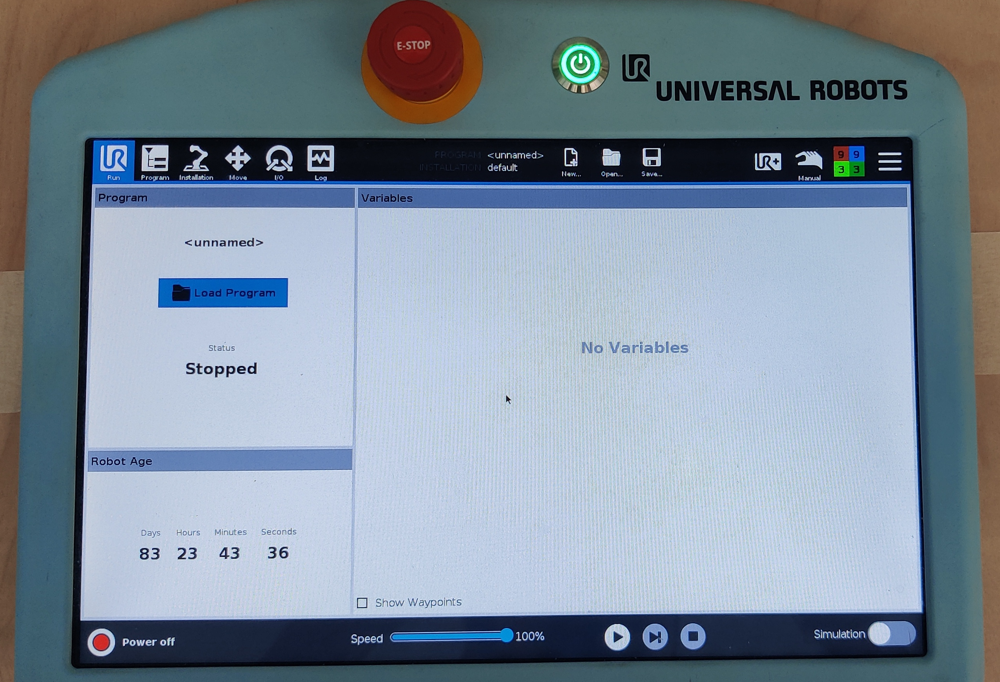
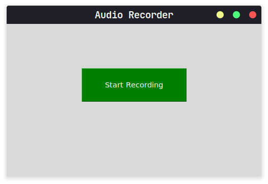

# Scrubnurse (ROS 2 Humble)

A UR10e acts as a scrub nurse. The surgeon asks for an instrument by voice and
the robot hands it over from the magazine. When the surgeon puts an instrument
back on the table, the overhead camera detects it and the robot returns it to
the return rack.

This workspace is the ROS 2 Humble port of the Scrubnurse proof of concept
built on ROS 1 Noetic. It ports every ROS 1 package the Scrubnurse
used:

- `voice_recognition_scrubnurse`
- `od_scrubnurse`
- `od_homography`, including its calibration tool
- `media_streamer` (Azure Kinect)
- `robot_controller`

The UR driver and MoveIt configuration come from apt.

You can run it in three ways:

| Mode | Needs | Launch file |
|---|---|---|
| Mock robot | Nothing but this PC | `mock.launch.py` |
| Gazebo simulation | Nothing but this PC (WSL works) | `sim.launch.py` |
| Real cell | UR10e, Robotiq gripper, Azure Kinect, microphone | `real.launch.py` |

## Contents

- [How it works](#how-it-works)
- [Installation](#installation)
- [Build and test](#build-and-test)
- [Running](#running)
- [Configuration](#configuration)
- [Calibration](#calibration)
- [Interfaces](#interfaces)
- [Troubleshooting](#troubleshooting)
- [Behaviour changes compared with ROS 1](#behaviour-changes-compared-with-ros-1)
- [Status](#status)

## How it works

```
microphone ─► voice_command ──(/tool_request, String "B")─────────────────────────┐
camera ─► tool_detector ──(/tool_detections_2d)─► tool_localizer ──(/tool_detections)─┤
                                                                                     ▼
                                     scrubnurse_controller ─► MoveIt 2 ─► UR10e + Robotiq gripper
```

1. **Voice:** `voice_command` records a few seconds of audio, transcribes it with Whisper and
   maps the spoken name to a tool id.
2. **Detection:** `tool_detector` segments the instruments in the overhead camera image with YOLO
   and estimates each one's heading from its mask.
3. **Localization:** `tool_localizer` converts pixels to robot coordinates on the table with a
   calibrated homography.
4. **Control:** `scrubnurse_controller` hands requested tools over first. When none are queued, it
   returns tools lying in the table's return area to the rack. It moves along straight lines
   between taught poses with MoveIt 2 and drives the gripper.

Tool ids:

| Id | Instrument |
|---|---|
| A | pointed scissors |
| B | needle holder |
| C | mosquito clamp |
| D | scalpel |
| E | anatomical forceps |
| F | surgical forceps |

### Packages

| Package | Contents |
|---|---|
| `scrubnurse_perception` | `kinect_camera` (Azure Kinect driver), `tool_detector` (YOLO segmentation → pixel position + heading), `tool_localizer` (homography → grasp pose), `collect_calibration` and `compute_homography` (camera calibration) |
| `scrubnurse_voice` | `voice_command` (Whisper speech → tool id, with a record-button window) |
| `scrubnurse_control` | `scrubnurse_controller` (task logic, MoveIt 2 motions, Robotiq gripper), `record_pose` (teach new poses) |
| `scrubnurse_bringup` | Launch files and cell configuration: `scrubnurse.yaml`, `poses.yaml`, `sim.yaml`, UR10e and camera calibration |
| `scrubnurse_sim` | Gazebo cell, plus the `sim_gripper`, `sim_tool_detector` and `sim_surgeon` helpers |

```
scrubnurse_ws/
├── README.md
├── requirements.txt          pip-only Python packages (installed into .venv)
├── requirements-camera.txt   pyk4a, only on the PC with the Azure Kinect
├── scripts/
│   ├── setup_venv.sh         creates/updates .venv
│   └── activate.sh           source in every terminal: ROS + .venv + workspace
├── docs/media/               pendant and GUI screenshots
└── src/
    ├── scrubnurse_bringup/   launch/ and config/
    ├── scrubnurse_control/
    ├── scrubnurse_perception/   (models/ holds the YOLO weights)
    ├── scrubnurse_sim/       urdf/, worlds/, models/, scripts/generate_world.py
    └── scrubnurse_voice/
```

## Installation

You need Ubuntu 22.04 (native or WSL 2) and about 10 GB of disk space. All steps are run once per
machine.

### 1. ROS 2 Humble

If ROS 2 Humble isn't installed yet, follow the official guide:
<https://docs.ros.org/en/humble/Installation/Ubuntu-Install-Debs.html>. Install `ros-humble-desktop`.

### 2. Tools

```bash
sudo apt update
sudo apt install -y git python3-venv python3-pip python3-rosdep python3-colcon-common-extensions
sudo rosdep init      # skip if it says it was already initialised
rosdep update
```

### 3. Get the code and its system dependencies

```bash
git clone https://github.com/jayBhagiya/scrubnurse_ws.git
cd scrubnurse_ws
source /opt/ros/humble/setup.bash
rosdep install --from-paths src --ignore-src -y
```

`rosdep` reads every `package.xml` and installs the ROS and Ubuntu packages they list. That covers
the UR driver, MoveIt 2, `pymoveit2`, Gazebo (`ur_simulation_gz`, `ros_gz`), ros2_control,
`vision_msgs`, PortAudio and others.

### 4. Python virtual environment

```bash
./scripts/setup_venv.sh
```

This creates `.venv` with the packages that only exist on PyPI: PyTorch, Ultralytics (YOLO),
OpenAI Whisper, sounddevice and soundfile. It follows the ROS 2 guide *Using Python packages with
ROS 2*:

- The venv is created with `--system-site-packages`, so ROS's Python packages stay visible.
- It contains a `COLCON_IGNORE` file, so colcon doesn't scan it.
- **No GPU is required.** The script picks the PyTorch build from the NVIDIA driver:

  | Machine | Build |
  |---|---|
  | RTX 50xx with driver ≥ 570.26 | CUDA 12.8 |
  | Older NVIDIA GPU with driver ≥ 560.28 | CUDA 12.6 |
  | Anything else | CPU |

  To force a build, run `TORCH_BUILD=cpu ./scripts/setup_venv.sh` (or `cu126`, `cu128`). On CPU,
  YOLO and Whisper still work, only more slowly. Set the voice model to `small.en` (see
  [Configuration](#configuration)) to keep voice responsive.
- A venv contains absolute paths, so never copy it to another machine or commit it. Run the
  script again on each machine, and again after `requirements.txt` changes.

### 5. Azure Kinect SDK (only on the PC with the camera)

The camera node uses `pyk4a`, which builds against the Azure Kinect SDK. Microsoft publishes the
SDK for Ubuntu 18.04 only, but these packages also install on 22.04:

```bash
cd /tmp
curl -sSLO https://packages.microsoft.com/ubuntu/18.04/prod/pool/main/libk/libk4a1.4/libk4a1.4_1.4.1_amd64.deb
curl -sSLO https://packages.microsoft.com/ubuntu/18.04/prod/pool/main/libk/libk4a1.4-dev/libk4a1.4-dev_1.4.1_amd64.deb
sudo apt install ./libk4a1.4_1.4.1_amd64.deb ./libk4a1.4-dev_1.4.1_amd64.deb   # accept the licence prompt
# Let normal users open the camera:
sudo curl -sSL -o /etc/udev/rules.d/99-k4a.rules \
  https://raw.githubusercontent.com/microsoft/Azure-Kinect-Sensor-SDK/develop/scripts/99-k4a.rules
sudo udevadm control --reload-rules && sudo udevadm trigger
cd -
./scripts/setup_venv.sh      # now also installs pyk4a
```

Replug the camera after installing the udev rule.

## Build and test

In **every new terminal**, source the environment first. This works in bash and zsh, from any
directory:

```bash
source scripts/activate.sh          # ROS 2, then .venv, then this workspace's install/
```

Then build:

```bash
python -m colcon build --symlink-install
source scripts/activate.sh          # once after the first build, so install/ is picked up
```

Use `python -m colcon`, not plain `colcon`, when building with `--symlink-install`. That way the
node executables run with the venv's Python. A plain `colcon build`, without symlinks, also works.

Run the tests:

```bash
colcon test && colcon test-result --verbose
```

The six Whisper tests transcribe recorded tool names. They are skipped by default because they
download a 1.5 GB model. To run them:
`SCRUBNURSE_WHISPER_TESTS=1 colcon test --packages-select scrubnurse_voice`.

## Running

The controller always starts **paused**. Nothing moves until you resume it.

### Mock robot (no hardware)

```bash
ros2 launch scrubnurse_bringup mock.launch.py
# second terminal (source scripts/activate.sh first):
ros2 service call /scrubnurse_controller/resume std_srvs/srv/Trigger
ros2 topic pub --once /tool_request std_msgs/msg/String "{data: B}"
```

The UR10e runs on ros2_control mock hardware with MoveIt 2 and RViz, with a mock gripper and no
camera or voice. Use it to check motion sequences after changing poses or parameters.

### Gazebo simulation

```bash
ros2 launch scrubnurse_bringup sim.launch.py      # add gazebo_gui:=false launch_rviz:=false for headless
# second terminal:
ros2 service call /scrubnurse_controller/resume std_srvs/srv/Trigger
ros2 topic pub --once /tool_request std_msgs/msg/String "{data: B}"
```

The simulated cell (Gazebo Fortress) contains:

- the UR10e with a simplified Hand-E-like gripper;
- the work table, with tool C already lying in the return area;
- the magazine with tools A–F standing upright;
- the surgeon's hand at the handover pose;
- the upright return rack.

After you resume, the controller returns tool C, then serves requests. The controller, localizer
and motion code run unchanged. The simulation replaces three things:

- **Tool detection.** `sim_tool_detector` projects the true tool poses into a virtual overhead
  camera mounted like the real one. The YOLO model is trained on real instruments and doesn't
  recognise the simulated stand-ins.
- **Gripper.** `sim_gripper` offers the same `GripperCommand` action as a ros2_control gripper. It
  attaches the tool between the fingers with a Gazebo detachable joint.
- **Surgeon.** `sim_surgeon` takes a handed-over tool at once and lays it back on the table 15 s
  later, so the controller returns it. That runs the whole cycle: request, handover, return.

The holders are placed where the recorded poses put a held tool. The world is generated from
`poses.yaml`, so regenerate it after re-teaching poses:

```bash
cd src/scrubnurse_sim
python3 scripts/generate_world.py ../scrubnurse_bringup/config/poses.yaml worlds/scrubnurse_cell.sdf
```

Options:

- `camera:=true` also spawns a rendered overhead camera on `/overhead_camera/image`, for viewing
  only.
- `render_engine:=ogre2` looks better on native Linux. Keep the default `ogre` under WSL, where
  Ogre 2 crashes.
- `voice:=true` starts the voice node. It needs a microphone.

### Real cell

**Once per robot (pendant):**

- Install the **External Control** URCap. Set *Host IP* to the ROS PC's address on the robot
  network and *Custom port* to 50002.
- Install the **Robotiq Grippers** URCap. The controller talks to the gripper through its socket
  on port 63352.
- Create a program that contains the External Control node.
- Give the ROS PC a static address in the robot's subnet.

**Every run:**

1. Connect the robot LAN, the camera (USB 3) and the microphone. Power on the UR10e.
2. On the pendant, load the External Control program and power on the arm.

   

3. Start everything, then press **Play** on the pendant:

   ```bash
   ros2 launch scrubnurse_bringup real.launch.py robot_ip:=<robot ip>   # camera:=false launch_rviz:=false
   ```

   This starts the UR driver, MoveIt 2, the Azure Kinect, the detector, the localizer, the voice
   window and the controller.
4. Check the scene: tools in the magazine, nothing in the robot's way. Then resume:

   ```bash
   ros2 service call /scrubnurse_controller/resume std_srvs/srv/Trigger
   ```

5. Click **Start Recording** in the voice window and say a tool name, for example "scalpel".

   

For a first run, keep the defaults:

- the controller pauses after every task (`step_mode`);
- the arm runs at 10% speed;
- keep a hand on the emergency stop.

### Operator control

The ROS 1 controller asked for Enter or `y` at the keyboard. In this port:

| Action | Command |
|---|---|
| Start, or continue after a pause | `ros2 service call /scrubnurse_controller/resume std_srvs/srv/Trigger` |
| Pause after the current task | `ros2 service call /scrubnurse_controller/pause std_srvs/srv/Trigger` |
| Request a tool without voice | `ros2 topic pub --once /tool_request std_msgs/msg/String "{data: D}"` |
| Watch the state | `ros2 topic echo /scrubnurse_controller/status` |
| Stop the arm now | Ctrl-C in the launch terminal (cancels the trajectory), or the emergency stop |

With `step_mode: true` (the default) the controller pauses again after every task. After any
failure it pauses and reports the reason on its status topic.

## Configuration

All cell parameters are in `src/scrubnurse_bringup/config/`. With `--symlink-install`, edits take
effect on the next launch, without a rebuild.

| File | Contents |
|---|---|
| `scrubnurse.yaml` | Parameters of all nodes on the real cell |
| `sim.yaml` | Overrides for Gazebo, loaded after `scrubnurse.yaml` |
| `poses.yaml` | 38 named `tool0` poses: magazine, handover, return rack, home |
| `ur10e_calibration.yaml` | Example UR10e factory kinematics; extract your own (below) |
| `azure_kinect_rgb_1080P.yaml` | Example Azure Kinect intrinsics; replace with your camera's |

Parameters you are most likely to change:

| Node | Parameter | Default | Meaning |
|---|---|---|---|
| `scrubnurse_controller` | `velocity_scaling` | 0.1 | Arm speed (0–1), applied to every motion |
| | `start_paused`, `step_mode` | true | Wait for `~/resume` at start / after every task |
| | `motion_timeout` | 10.0 | Cancel a motion running this much longer than planned (s) |
| | `gripper.host`, `gripper.port` | `robot_ip`, 63352 | Robotiq URCap socket |
| | `return_area` | x −0.18..0.22, y −1.20..−0.75 | Table area whose tools are returned |
| `tool_detector` | `device` | cuda:0 | `cpu` if there is no GPU (also falls back automatically) |
| | `confidence_threshold` | 0.5 | Minimum YOLO score |
| | `roi_polygon` | table area | Pixels of the work area; `use_roi: false` to disable |
| `tool_localizer` | `homography` | 2024-11-22 calibration | Pixel → robot matrix (see [Calibration](#calibration)) |
| `voice_command` | `model` | medium.en | Whisper model; `small.en` or `base.en` on CPU |
| | `record_seconds` | 5.0 | Length of one recording |
| | `input_device` | "" (default) | Microphone name or index; list them with `.venv/bin/python -m sounddevice` |
| `kinect_camera` | `serial` | "" | Camera to open; "" opens the first one |

**Using a different robot:** extract its factory calibration and point `real.launch.py` at it:

```bash
ros2 launch ur_calibration calibration_correction.launch.py robot_ip:=<ip> target_filename:=$PWD/my_robot_calibration.yaml
ros2 launch scrubnurse_bringup real.launch.py robot_ip:=<ip> kinematics_params_file:=$PWD/my_robot_calibration.yaml
```

**Coordinate frame:** cell coordinates (`poses.yaml`, the homography, `return_area`) are in the
UR **`base`** frame, the frame shown on the teach pendant. ROS 2's `base_link` is rotated 180°
about z from it.

## Calibration

Recalibrate when the camera moves or the cell is rebuilt.

**Camera → table homography.**

1. Start the real cell (or at least the camera, the detector and the robot driver).
2. Record pixel/robot pairs:

   ```bash
   ros2 run scrubnurse_perception collect_calibration --tool A -o pairs.csv
   ```

   For each pair, put one tool A on the table and press Enter. Then jog the gripper onto it and
   press Enter again. Spread the points over the whole work area. The current fit error is printed
   once you have four pairs. The 2024 calibration used 21 pairs.
3. Compute the matrix, then copy it into `tool_localizer.homography` in `scrubnurse.yaml`:

   ```bash
   ros2 run scrubnurse_perception compute_homography pairs.csv -o homography.yaml
   ```

The 2024-11-22 pairs are in `src/scrubnurse_perception/test/data/`. They reproduce the current
matrix to 1.4 mm on average.

**Robot poses (magazine, handover, return rack, home).**

1. Record poses:

   ```bash
   ros2 run scrubnurse_control record_pose -o new_poses.yaml
   ```

   Jog the robot, press Enter, and name the pose (for example `PA`).
2. Merge the entries into `poses.yaml`.
3. Check the sequences with `mock.launch.py`.
4. Regenerate the Gazebo world.

## Interfaces

| Name | Type | Between |
|---|---|---|
| `/od_camera/stream/rgb`, `/od_camera/stream/depth`, `/od_camera/camera_info` | `sensor_msgs/Image`, `CameraInfo` | `kinect_camera` → `tool_detector` |
| `/tool_detections_2d` | `vision_msgs/Detection2DArray` | `tool_detector` → `tool_localizer`. Pixels; tool heading in `bbox.center.theta` |
| `/tool_detections` | `vision_msgs/Detection3DArray` | `tool_localizer` → controller. Grasp poses in `base`; TF frames `tool_<id>_<n>` |
| `/tool_detector/annotated_image` | `sensor_msgs/Image` | Detections drawn on the camera image (view with `rqt_image_view`) |
| `/tool_request` | `std_msgs/String` | `voice_command` → controller. Tool id, for example `B` |
| `/voice_command/transcript` | `std_msgs/String` | Every Whisper transcript |
| `/voice_command/listen` | `std_srvs/Trigger` | Record and transcribe without the window |
| `/scrubnurse_controller/status` | `std_msgs/String` (latched) | Controller state |
| `/scrubnurse_controller/resume`, `/pause` | `std_srvs/Trigger` | Operator control |

## Troubleshooting

| Symptom | Cause and fix |
|---|---|
| `ros2: command not found`, or packages not found | Run `source scripts/activate.sh` in this terminal. |
| `No venv yet` when sourcing | Run `./scripts/setup_venv.sh`. |
| Nothing moves after launch | The controller starts paused. Call `~/resume` (see [Operator control](#operator-control)). |
| `Cannot plan because no joint states were received` | The robot controllers aren't running. Check the launch log for failed `spawner` processes. On a real robot, press Play on the pendant. |
| Gazebo spawners time out (`Failed getting a result from calling /controller_manager/load_controller`) | Usually the rendered camera starting at the same time. Launch without `camera:=true`. |
| Gazebo crashes with an `Ogre::UnimplementedException` under WSL | Keep `render_engine:=ogre` (the default). |
| Two people on the same network see each other's robots | Give each one their own ROS domain: `export ROS_DOMAIN_ID=<0..101>` before launching. |
| Strange behaviour after a crashed launch | Leftover nodes may still run. Check with `ps aux \| grep -E "move_group\|ros2_control_node\|scrubnurse"` and end them. |
| YOLO or Whisper is slow | Check `.venv/bin/python -c "import torch; print(torch.cuda.is_available())"`. If False on a GPU machine, update the NVIDIA driver and rerun `./scripts/setup_venv.sh`. |
| `numpy` / `cv_bridge` import errors after installing extra pip packages | Humble needs NumPy 1.x. Rerun `./scripts/setup_venv.sh` to restore the pinned versions. |
| Gripper activation fails on the real robot | Check that the Robotiq Grippers URCap is installed and that `gripper.host` is the robot IP. |
| `kinect_camera` fails with `no Azure Kinect connected` | Check the USB 3 connection and the udev rule, and run `k4aviewer` if you have it. With several cameras, set `serial`. |

## Behaviour changes compared with ROS 1

- **Messages:** JSON-in-`std_msgs/String` topics were replaced by `vision_msgs` detections. The
  separate database node is gone; the controller reads `/tool_detections` directly.
- **Partial paths:** a straight-line path only runs if at least 95% of it could be planned. ROS 1
  executed partial paths.
- **Speed:** the default arm speed is 10% (`velocity_scaling`), and it also applies to straight-line
  moves. On Humble, MoveIt returns straight-line paths timed at full speed, so the controller
  retimes them to `velocity_scaling` before executing.
- **Stale detections:** a detection is only used if it is less than 1 s old and the image was taken
  after the arm stopped moving. ROS 1 kept re-publishing the last detection forever.
- **Return area:** a tool outside the return area no longer blocks the tools that are inside it.
- **Timeouts:** gripper waits and arm motions time out (`motion_timeout`) instead of hanging. The
  UR MoveIt configuration disables MoveIt's own execution monitoring.
- **Stopping:** Ctrl-C (or SIGTERM from `ros2 launch`) cancels the running trajectory, so the arm
  stops, and then the controller exits.
- **Keyboard prompts** became the `~/resume` and `~/pause` services, plus `step_mode`.
- **Whisper** loads once at startup instead of on every recording. A sentence such as "the scalpel
  please" now also matches.

## Status

- [x] All Scrubnurse packages ported, with unit tests against the ROS 1 behaviour
- [x] Mock-hardware and Gazebo launches. The full cycle (request, handover, return) runs in Gazebo.
- [ ] First run on the real cell. The Azure Kinect driver, the Robotiq socket gripper and the
      calibration tool haven't run on hardware yet.
- [ ] License: all packages say `TODO`.
