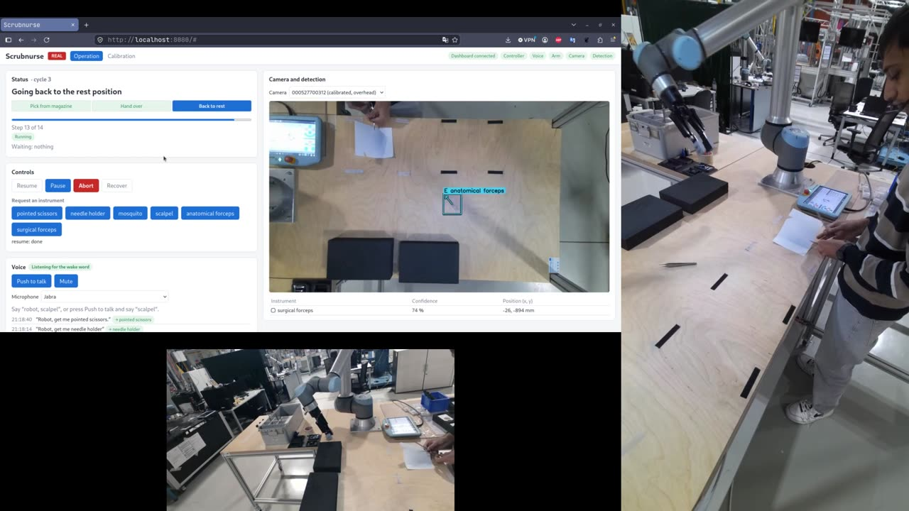
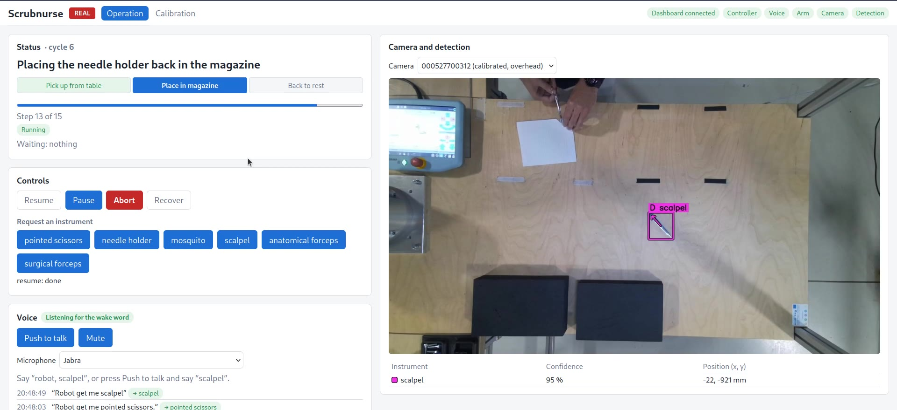
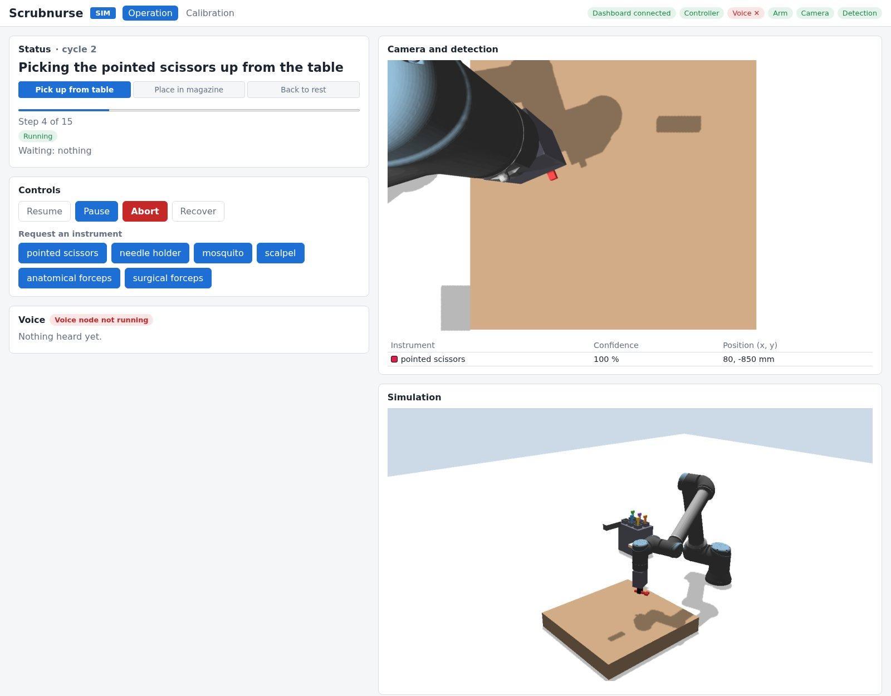
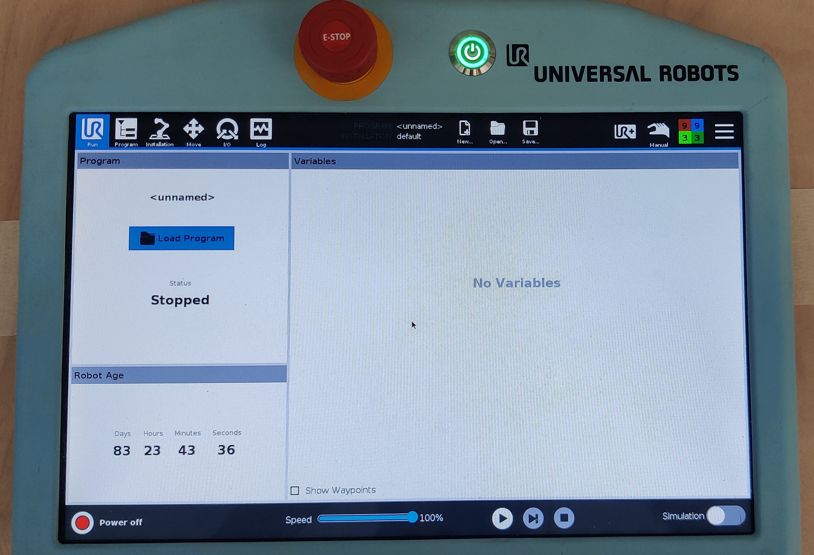

# Scrubnurse (ROS 2 Humble)

[](https://github.com/jayBhagiya/scrubnurse_ws/actions/workflows/ci.yml)

A UR10e acts as a scrub nurse. The surgeon asks for an instrument by voice and the robot hands it
over from the magazine. When the surgeon puts an instrument back on the table, the overhead camera
detects it and the robot returns it to the magazine. A web dashboard shows and controls the whole
cycle.

[](https://youtu.be/0U6RoegLIow)

*▶ [Watch a full run on the real cell](https://youtu.be/0U6RoegLIow): dashboard, side view and
front view.*



## Three ways to run it

| | Path | For | Needs |
|---|---|---|---|
| 1 | [Simulation in Docker](#1-simulation-in-docker) | Seeing the whole cycle run | Docker only |
| 2 | [Simulation on your PC](#2-simulation-on-your-pc) | Changing code, poses or parameters | Ubuntu 22.04 + ROS 2 Humble ([Installation](#installation)) |
| 3 | [Real cell](#3-real-cell) | Running the robot | Path 2's installation, plus a UR10e, Robotiq gripper, Azure Kinect and microphone |

All three use the same dashboard at http://localhost:8080 ([Operating the cell](#operating-the-cell)).

## Contents

- [How it works](#how-it-works)
- [1. Simulation in Docker](#1-simulation-in-docker)
- [2. Simulation on your PC](#2-simulation-on-your-pc)
  - [Installation](#installation)
  - [Gazebo simulation](#gazebo-simulation)
  - [Mock robot](#mock-robot)
- [3. Real cell](#3-real-cell)
  - [Running the cell](#running-the-cell)
  - [Camera calibration](#camera-calibration)
  - [Robot poses](#robot-poses)
- [Operating the cell](#operating-the-cell)
- [Configuration](#configuration)
- [Interfaces](#interfaces)
- [Troubleshooting](#troubleshooting)

## How it works

```
microphone ─► voice_command ──(/tool_request, String "B")─────────────────────────┐
camera ─► tool_detector ──(/tool_detections_2d)─► tool_localizer ──(/tool_detections)─┤
                                                                                     ▼
                     dashboard ◄──► scrubnurse_controller ─► MoveIt 2 ─► UR10e + Robotiq gripper
```

1. **Voice:** `voice_command` listens all the time and transcribes each phrase with Whisper. A
   phrase counts if it contains a wake word and a tool name ("robot, scalpel"), or follows
   **Push to talk** on the dashboard.
2. **Detection:** `tool_detector` segments the instruments in the overhead image with YOLO and
   estimates each one's heading from its mask.
3. **Localization:** `tool_localizer` converts pixels to robot coordinates on the table with a
   calibrated homography.
4. **Control:** `scrubnurse_controller` serves requests first. When none are queued, it returns
   tools lying in the table's return area. It moves between taught poses with MoveIt 2.
5. **Dashboard:** status, controls, the camera view with each detected tool in its own colour,
   the voice panel, the arm state, an event log and the calibration page.

| Id | Instrument | | Id | Instrument |
|---|---|---|---|---|
| A | pointed scissors | | D | scalpel |
| B | needle holder | | E | anatomical forceps |
| C | mosquito clamp | | F | surgical forceps |

| Package | Contents |
|---|---|
| `scrubnurse_perception` | `kinect_camera` (Azure Kinect), `tool_detector` (YOLO), `tool_localizer` (homography), `compute_homography` |
| `scrubnurse_voice` | `voice_command` (Whisper speech → tool id) |
| `scrubnurse_control` | `scrubnurse_controller` (task logic, motions, gripper), `record_pose` |
| `scrubnurse_dashboard` | FastAPI backend and React page |
| `scrubnurse_interfaces` | Status messages for the dashboard |
| `scrubnurse_bringup` | Launch files and cell configuration (`config/`) |
| `scrubnurse_sim` | Gazebo cell, simulated gripper, detector, surgeon and cameras |

## 1. Simulation in Docker

Nothing to install but Docker with Compose v2 (tested on Linux). The first build downloads and
compiles about 3.5 GB and takes a while.

```bash
git clone https://github.com/jayBhagiya/scrubnurse_ws.git && cd scrubnurse_ws
docker compose up --build
```

1. When the log quiets down (about a minute), open http://localhost:8080.
2. Press **Resume**. All six instruments start in the magazine.
3. Click an instrument under *Request an instrument*. The arm picks it from the magazine and hands
   it over; the simulated surgeon lays it back on the table 15 s later, and the arm returns it.



*Camera and detection* is the simulated overhead camera with the detected tools; *Simulation* is a
side view of the cell. Both are rendered by Gazebo inside the container, so no Gazebo window opens:
to watch the 3D scene in Gazebo itself, use [path 2](#gazebo-simulation).

Stop with Ctrl-C (or `docker compose down`). The containers use ROS domain 42
(`SIM_ROS_DOMAIN_ID`), so they don't disturb a robot on the same network. The dashboard is only
reachable from this PC.

To check the whole cycle without clicking, start the containers with `docker compose up -d` and run
`python3 scripts/sim_e2e_test.py`: it requests the scalpel and passes once it is back in the
magazine (about two minutes). CI runs it, together with all unit tests, on every push.

## 2. Simulation on your PC

### Installation

Ubuntu 22.04 (native or WSL 2), about 10 GB of disk. Once per machine; the real cell (path 3) needs
the same installation.

1. Install [ROS 2 Humble](https://docs.ros.org/en/humble/Installation/Ubuntu-Install-Debs.html)
   (`ros-humble-desktop`) and [Node.js](https://nodejs.org) 18 or newer (Ubuntu's own `nodejs`
   package is too old; [nvm](https://github.com/nvm-sh/nvm) works). Then:

   ```bash
   sudo apt install -y git python3-venv python3-pip python3-rosdep python3-colcon-common-extensions
   sudo rosdep init; rosdep update
   git clone https://github.com/jayBhagiya/scrubnurse_ws.git && cd scrubnurse_ws
   source /opt/ros/humble/setup.bash
   rosdep install --from-paths src --ignore-src -y   # UR driver, MoveIt 2, Gazebo, ...
   ./scripts/setup_venv.sh                           # .venv: PyTorch, YOLO, Whisper
   (cd src/scrubnurse_dashboard/web && npm ci && npm run build)   # the dashboard page
   ```

   The script picks a CUDA or CPU PyTorch build from the NVIDIA driver; force one with
   `TORCH_BUILD=cpu|cu126|cu128`. On CPU, set the Whisper model to `small.en`. Never copy the venv
   to another machine; rerun the script there. Rerun `npm run build` after changing the page.

2. **Only on the PC with the Azure Kinect (path 3):** install the SDK (published for 18.04, works
   on 22.04) and the udev rule, then replug the camera:

   ```bash
   cd /tmp
   curl -sSLO https://packages.microsoft.com/ubuntu/18.04/prod/pool/main/libk/libk4a1.4/libk4a1.4_1.4.1_amd64.deb
   curl -sSLO https://packages.microsoft.com/ubuntu/18.04/prod/pool/main/libk/libk4a1.4-dev/libk4a1.4-dev_1.4.1_amd64.deb
   sudo apt install ./libk4a1.4_1.4.1_amd64.deb ./libk4a1.4-dev_1.4.1_amd64.deb
   sudo curl -sSL -o /etc/udev/rules.d/99-k4a.rules \
     https://raw.githubusercontent.com/microsoft/Azure-Kinect-Sensor-SDK/develop/scripts/99-k4a.rules
   sudo udevadm control --reload-rules && sudo udevadm trigger
   cd - && ./scripts/setup_venv.sh                    # now also installs pyk4a
   ```

3. Build and test. Source `scripts/activate.sh` in **every new terminal** (ROS, venv, workspace):

   ```bash
   source scripts/activate.sh
   python -m colcon build --symlink-install   # python -m: nodes run with the venv's Python
   source scripts/activate.sh
   colcon test && colcon test-result --verbose
   ```

   The Whisper tests download a 1.5 GB model and are skipped unless
   `SCRUBNURSE_WHISPER_TESTS=1`.

### Gazebo simulation

```bash
ros2 launch scrubnurse_bringup sim.launch.py camera:=true
```

This opens Gazebo (the 3D cell) and RViz (MoveIt), and starts the dashboard. Open
http://localhost:8080 and press **Resume**, then request instruments as in path 1.

The simulation replaces three things; the controller, localizer and motion code run unchanged:

- **Detection:** `sim_tool_detector` projects the true tool poses into a virtual overhead camera
  (YOLO is trained on real instruments).
- **Gripper:** `sim_gripper` attaches the tool between the fingers.
- **Surgeon:** `sim_surgeon` takes each handed-over tool and lays it back on the table 15 s later.

Options:

- `camera:=true` renders the overhead camera and the side view for the dashboard (more CPU).
- `gazebo_gui:=false launch_rviz:=false` runs without windows.
- `voice:=true` starts the voice node (needs a microphone).
- `render_engine:=ogre2` looks better on native Linux; keep the default `ogre` under WSL.

After re-teaching poses, regenerate the world and the simulation's return poses (`scrubnurse_sim/config/poses.yaml`):
`python3 src/scrubnurse_sim/scripts/generate_world.py src/scrubnurse_bringup/config/poses.yaml src/scrubnurse_sim/worlds/scrubnurse_cell.sdf`.

### Mock robot

```bash
ros2 launch scrubnurse_bringup mock.launch.py
```

The UR10e on ros2_control mock hardware with MoveIt 2 and RViz, no camera or voice. Use it to
check motion sequences after changing poses.

## 3. Real cell

### Running the cell

**Once per robot (pendant):** install the **External Control** URCap (*Host IP*: the ROS PC,
*Custom port*: 50002) and the **Robotiq Grippers** URCap (socket port 63352), and create a program
containing the External Control node. Give the ROS PC a static address in the robot's subnet. If
the camera or table moved, [calibrate the camera](#camera-calibration) before the first run.

**Every run:**

1. Connect the robot LAN, the Azure Kinect (USB 3) and the microphone. Power on the arm and load
   the External Control program.

   

2. Set the pendant's speed slider low (10% for a first run): it sets the arm speed. Then start
   everything and press **Play** on the pendant:

   ```bash
   ros2 launch scrubnurse_bringup real.launch.py robot_ip:=<robot ip>   # launch_rviz:=false
   ```

   This starts the UR driver, MoveIt 2, the camera, detector, localizer, voice node, controller
   and dashboard.
3. Open http://localhost:8080. Check the scene (tools in the magazine, nothing in the way), keep a
   hand on the emergency stop and press **Resume**.
4. Say "robot, scalpel", or press **Push to talk** and say "scalpel".

**Continuous demo:** by default the controller pauses after every task (`step_mode`). For a demo
that runs without pausing, put this in `demo.yaml` and add
`override_params_file:=$PWD/demo.yaml` to the launch command:

```yaml
scrubnurse_controller:
  ros__parameters:
    step_mode: false
```

**Dashboard in Docker** (no Node.js on the robot PC): start `real.launch.py ... dashboard:=false`,
then `COMPOSE_FILE=compose.real.yaml HOST_UID=$(id -u) docker compose up --build`.

### Camera calibration

`tool_localizer` maps a tool's pixel position to x/y on the table (UR `base` frame) with a
homography. It is calibrated from pairs: where the camera sees a block, and where tool0 is when a
pointer in the gripper touches the block's centre. Recalibrate whenever the camera or the table
moves.

**You need:**

- **Calibration block:** 40 × 40 × 10 mm, printed in **matte black**:
  [`calibration_block.stl`](docs/calibration/calibration_block.stl) (source
  [`.scad`](docs/calibration/calibration_block.scad)). A shallow cone in the top centre guides the
  pointer tip. The camera finds it as a dark square, so calibrate on the light table surface. Any
  dark 40 mm square object works too (for example a black PC fan).
- **Pointer:** anything with a sharp tip that the gripper holds vertically and centred between
  the fingers, such as a 3D-printed rod with a screwdriver-like tip or a real screwdriver. Its
  length doesn't matter (only x/y are used), but the tip must be on the tool0 axis: rotate the
  wrist 180° above a mark, and the tip should stay on the mark.

**Steps:**

1. Start the cell with `real.launch.py` (the controller stays paused). Close the gripper on the
   pointer. To jog with the pendant, stop the External Control program; the driver keeps
   publishing the arm position.
2. On the dashboard, open **Calibration**.
3. Put the block on the table and move the arm out of the camera view. When the block is outlined
   in green, click **Select pixel position** (the centre is averaged over one second).
4. Jog the pointer onto the block's centre: first in x/y above it, then down until the tip almost
   touches the cone, then correct x/y. Don't move the block. Click **Select reference position**.
5. Repeat for 20 or more positions spread over the whole return area, corners included.
6. Check the errors. *Unseen* is each pair against a fit made without it: how well the matrix
   predicts new positions. Remove pairs with an unseen error well above the rest (usually a
   mis-pointed tip) and record them again.
7. Click **Save pairs and homography** (written to `~/scrubnurse_calibration`). Copy the
   `homography` line into the `tool_localizer` section of `config/scrubnurse.yaml` and restart.

Saved pairs can be loaded again to add points later, or refitted on the command line:
`ros2 run scrubnurse_perception compute_homography pairs.csv -o homography.yaml`.

### Robot poses

The 38 magazine, handover, return and rest poses are in `config/poses.yaml`. To re-teach one, jog
the robot and run `ros2 run scrubnurse_control record_pose -o new_poses.yaml` (press Enter, name
the pose, e.g. `PA`). Merge the entries into `poses.yaml`, check with `mock.launch.py` and
regenerate the Gazebo world.

**A different UR10e:** extract its factory calibration and pass it to the launch:

```bash
ros2 launch ur_calibration calibration_correction.launch.py robot_ip:=<ip> target_filename:=$PWD/my_robot.yaml
ros2 launch scrubnurse_bringup real.launch.py robot_ip:=<ip> kinematics_params_file:=$PWD/my_robot.yaml
```

Cell coordinates (`poses.yaml`, the homography, `return_area`) are in the UR **`base`** frame, as
shown on the pendant; ROS 2's `base_link` is rotated 180° about z from it.

## Operating the cell

The controller always starts **paused**: nothing moves until you press **Resume**.

| Dashboard | Does |
|---|---|
| **Resume / Pause** | Start or continue; pause after the current task |
| **Abort** | Stop the arm now and clear the request queue |
| **Recover** | After an abort, move to the rest pose, then pause (confirm the arm is clear) |
| Instrument buttons | Request a tool without voice |
| **Push to talk / Mute**, Microphone | Voice input; the microphone switches live |
| Camera | Switch Azure Kinect (warns when it isn't the calibrated one) |

The same from a terminal: `ros2 service call /scrubnurse_controller/resume std_srvs/srv/Trigger`
(`/pause`, `/abort`, `/recover`), and `ros2 topic pub --once /tool_request std_msgs/msg/String
"{data: D}"`. Ctrl-C in the launch terminal cancels the trajectory and stops the arm.

## Configuration

All parameters are in `src/scrubnurse_bringup/config/scrubnurse.yaml` (`sim.yaml` overrides it in
Gazebo). With `--symlink-install`, edits apply on the next launch without a rebuild.

| Node | Parameter | Meaning |
|---|---|---|
| `scrubnurse_controller` | `start_paused`, `step_mode` | Wait for Resume at start / after every task (both `true`) |
| | `velocity_scaling` | Arm speed 0–1; leave 1.0 on the real cell and use the pendant slider |
| | `motion_timeout` | Cancel a motion running this much longer than planned (s) |
| | `return_area` | Table area whose tools are returned |
| `tool_detector` | `device`, `confidence_threshold`, `roi_polygon` | `cpu` without GPU; minimum YOLO score; work-area pixels |
| `tool_localizer` | `homography` | Pixel → robot matrix (see [Camera calibration](#camera-calibration)) |
| `voice_command` | `model` | Whisper model; `small.en` on CPU |
| | `input_device` | Microphone name substring (ALSA numbers change between boots) |
| | `wake_words`, `tool_names` | What the voice node listens for |
| `kinect_camera` | `serial` | The overhead Azure Kinect; "" only with a single camera connected |
| `scrubnurse_dashboard` | `calibration_block_px`, `calibration_roi`, `calibration_dir` | Block size in pixels, search area, save folder |

## Interfaces

| Name | Type | Between |
|---|---|---|
| `/od_camera/stream/rgb`, `/od_camera/camera_info` | `Image`, `CameraInfo` | `kinect_camera` → `tool_detector` |
| `/tool_detections_2d` | `vision_msgs/Detection2DArray` | `tool_detector` → `tool_localizer` (pixels, heading in `bbox.center.theta`) |
| `/tool_detections` | `vision_msgs/Detection3DArray` | `tool_localizer` → controller (grasp poses in `base`) |
| `/tool_request` | `std_msgs/String` | voice / dashboard → controller (tool id, e.g. `B`) |
| `/scrubnurse_controller/status` | `std_msgs/String` (latched) | Controller state |
| `/scrubnurse_controller/cycle` | `scrubnurse_interfaces/CycleStatus` (latched) | Current task and queue, for the dashboard |
| `/scrubnurse_controller/resume`, `/pause`, `/abort`, `/recover` | `std_srvs/Trigger` | Operator control |
| `/voice_command/transcript`, `/voice_command/listen` | `String`, `Trigger` | Every transcript; push-to-talk |
| `/voice_command/events` | `scrubnurse_interfaces/VoiceEvent` | Heard phrases and their outcome, for the dashboard |
| `/voice_command/status` | `scrubnurse_interfaces/VoiceStatus` (latched) | Listening, muted, microphones |
| `/kinect_camera/status` | `scrubnurse_interfaces/CameraStatus` (latched) | Streaming camera and connected ones |
| `/overhead_camera/image`, `/scene_camera/image` | `Image` | Simulation only: overhead camera, side view for the dashboard |

## Troubleshooting

| Symptom | Fix |
|---|---|
| Dashboard page is empty (`{"detail":"Not Found"}`) | The page isn't built: `cd src/scrubnurse_dashboard/web && npm ci && npm run build`, then rebuild with colcon. |
| `ros2: command not found` or packages not found | `source scripts/activate.sh` in this terminal (`./scripts/setup_venv.sh` first if there is no venv). |
| Nothing moves after launch | The controller starts paused: press **Resume**. |
| No camera images or *Simulation* panel in the simulation | Start `sim.launch.py` with `camera:=true`; the cameras start once the arm controllers are up. |
| `Cannot plan because no joint states were received` | The robot controllers aren't running: press Play on the pendant, check the log for failed spawners. |
| Gazebo crashes with `Ogre::UnimplementedException` (WSL) | Keep `render_engine:=ogre`. |
| Two people's robots interfere on one network | Give each one a ROS domain: `export ROS_DOMAIN_ID=<0..101>`. |
| YOLO or Whisper is slow | `.venv/bin/python -c "import torch; print(torch.cuda.is_available())"`; if False on a GPU machine, update the driver and rerun `setup_venv.sh`. |
| `numpy` / `cv_bridge` errors after extra pip installs | Humble needs NumPy 1.x: rerun `./scripts/setup_venv.sh`. |
| Gripper activation fails | Check the Robotiq Grippers URCap and that `gripper.host` is the robot IP. |
| `kinect_camera`: no Azure Kinect / wrong camera | Check USB 3 and the udev rule. With several cameras, `serial` must name the overhead one; the node lists the connected serials. |
| Voice panel hears nothing | Pick the microphone on the dashboard, and check that it isn't muted in the system mixer. |
